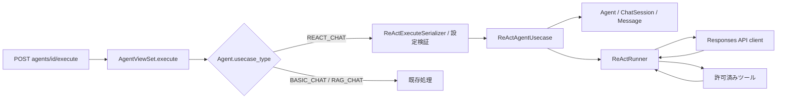

# バックエンド実装講義: Usecase を中心に ReAct Agent を組み込む

## 1. 講義の位置付け

[06_react_agent.py](../../../scripts/api_basics/06_react_agent.py) の「判断 → ツール実行 → 結果の観測」を、Django REST Framework の既存 Agent 実行 API へ組み込む講義です。React の画面開発ではありません。以降、エージェントの方式を **ReAct**、参照スクリプトの Python クラス名を `ReActAgent` と表記します。

主題は Usecase です。HTTP を受け取る View と、入力を検証する Serializer、状態を保存する Model を組み合わせ、「どの順番で処理し、どこまで成功したら保存するか」を実装します。単に参照スクリプトを View に貼り付ける演習にはしません。

この資料は講師用の進行案と受講者向けの学習案内です。ReAct は **既存の `POST /api/agents/{id}/execute/` に演習で追加する機能であり、現在のバックエンドに実装済みではありません**。新しい対話 Route は作りません。本教材の追加自体ではアプリケーションを変更しません。

具体的なコード例と検証手順は [ReAct Agent バックエンド実装資料](react-agent-backend-implementation.md) を参照してください。

### 到達目標

- View、Serializer、Usecase、Model、外部 API クライアントの責務を説明できる。
- モデルが関数を直接実行するのではなく、サーバーが許可したツールだけを実行することを説明できる。
- `response.output`、`function_call`、`function_call_output`、`call_id` の関係を説明できる。
- ReAct の反復処理と会話の保存処理を分離して実装できる。
- 同じ会話 UUID で対話を継続し、失敗時に中途半端なメッセージを残さない実装を説明できる。
- Agent の `usecase_type` に `REACT_CHAT` を追加し、既存 `execute` の機能として呼び出せる。
- 講義で配布する API キーを使って GPT-6 luna を LLM に登録し、ReAct Agent へ関連付けて利用できる。
- 実 API に依存せず、正常終了、上限到達、ツールエラー、HTTP 入力エラーを検証できる。

### 前提知識と準備

- Python の関数、クラス、辞書、例外、`with` 文、JSON の基礎。
- HTTP の POST、JSON リクエスト、ステータスコードの基礎。
- Django ORM の `get`、`create`、関連モデル取得、`transaction.atomic` の基礎。
- [ORM・データベース・テスト・デバッグ演習](orm-database-debug-workshop.md) 相当の環境。環境構築自体は本講義の時間に含めません。
- テスト実行用の backend 環境と、講義で配布する API キー。単体テストはキーなしで実行し、最後の実機演習で GPT-6 luna に接続します。
- LLM の登録値は表示名 `GPT-6 luna`、provider `OPENAI`、model `gpt-6-luna`、base URL `https://api.openai.com/v1`、`is_active=true` とします。講義環境で別の接続先が案内された場合のみ base URL をその値へ変更します。API キーは講義用の管理画面へ直接入力し、ソース・提出物・チャットへ転記しません。

## 2. 現在の実装から出発する

| 観察対象 | 現在の振る舞い | 講義で扱う点 |
| --- | --- | --- |
| [参照スクリプト](../../../scripts/api_basics/06_react_agent.py) | `responses.create` を反復し、登録済み Python 関数を実行する。履歴は実行ごとに初期化する | ReAct ループの原型 |
| [ChatSessionViewSet.chat](../../../backend/core/views.py) | 入力を取り出し、`ChatInSessionUsecase` を呼ぶ | HTTP とアプリケーション処理の境界 |
| [ChatInSessionUsecase](../../../backend/core/usecases.py) | user 保存 → 履歴取得 → `client.chat` → assistant 保存を行う | Usecase の役割とトランザクション |
| [AgentViewSet.execute](../../../backend/core/views.py) | BASIC_CHAT / RAG_CHAT の分岐と保存処理を View 内で行う | すべての既存処理が Usecase 化されているわけではない |
| [Serializer](../../../backend/core/serializers.py) | API のフィールドと入力検証を定義する | `validated_data` から安全に Usecase へ渡す |
| [Model](../../../backend/core/models.py) | `ChatSession` が LLM を参照し、`Message` が会話に属する | 既存テーブルで保存できる範囲 |
| [LLM クライアント](../../../backend/core/llm_clients.py) | 共通の `chat` は本文と usage を返す。OpenAI 実装は Chat Completions を使う | Responses API の出力全体を扱う専用クライアントが必要 |

`options` に `tools` を加えるだけでは参照例を移植できません。既存の `ChatResult` にはツール呼び出しや `call_id` がなく、OpenAI 実装も `tools` を送信対象にしていません。この違いを、実装前に説明します。

## 3. 演習で採用する構成

`Agent.usecase_type` に `REACT_CHAT` を追加し、既存の `POST /api/agents/{id}/execute/` で実行方式を選択します。BASIC_CHAT / RAG_CHAT の動作と既存の応答形式は維持します。通常の `/chat/` や Router は変更せず、新しい Route は追加しません。

リクエストは既存と同じ `input`、継続時の `session_uuid`、`options` を使います。ReAct の上限は `options.max_steps` で指定します。応答も `agent_id`、`session_uuid`、`result.message`、`usage` に揃えます。Model choices、Serializer の許可値、migration、View の分岐、API 契約の更新を、講義の実装範囲に含めます。

| 層 | 担当すること | 担当しないこと |
| --- | --- | --- |
| View | 認証済みリクエストの受付、Agent の取得、実行方式の分岐、HTTP 応答への変換 | ReAct ループ、ツールの直接実行 |
| Serializer | 空文字、型、長さ、ステップ上限の検証 | DB への会話保存、外部 LLM 呼び出し |
| Usecase | Agent に属する会話の新規作成・再利用、履歴の取得、Runner 呼び出し、成功した対話の保存 | HTTP ステータスコードの決定、SDK 固有オブジェクトの操作 |
| Runner | 判断・実行・観測の反復と終了条件 | Django ORM と HTTP 応答 |
| Model | 会話とメッセージの永続化 | LLM の行動判断 |
| Client / Tools | 外部 API 通信 / 許可された小さな処理 | リクエスト全体の進行管理 |

### 最小実装で決めておくこと

- ツールは参照例の価格取得と四則演算のみ。任意のコード、ファイル操作、外部送信は許可しません。
- 講義で配布する API キーで `GPT-6 luna`（`gpt-6-luna`）を OPENAI の LLM として登録し、`REACT_CHAT` の Agent から参照します。既存の Ollama / Gemini への対応は対象外です。
- ReAct の分岐は、既存 View の options 結合・会話作成・system メッセージ保存より前に置きます。初回の失敗で空の会話を作らず、他 Agent に属する UUID は 404 にします。
- Agent の `system_prompt` は Runner の指示へ渡します。DB に system メッセージを重複保存せず、`Agent.tools` による任意ツールの有効化は行いません。
- SDK の履歴は 1 リクエストのメモリ内に保持します。DB には利用者の発言と最終回答だけを保存し、ツールの実行結果やモデル内部の推論過程は保存・公開しません。
- 次のリクエストでは DB の user / assistant を読み直します。ツール実行中の中断・再開は扱いません。
- 外部通信は DB トランザクションの外で行い、成功後の user / assistant の保存だけを短いトランザクションでまとめます。
- 同一会話に対する同時送信、再送時の二重実行、会話履歴の圧縮は発展課題です。必修演習では 1 会話に逐次送信します。

## 4. 講義構成: 90 分 × 2 コマ

### 第 1 コマ: HTTP から独立した ReAct の実装

| 時間 | 内容 | 受講者が行うこと | 確認する成果 |
| --- | --- | --- | --- |
| 0–10 分 | 題材と完成形 | 「ノート 3 冊、1,000 円」の例を手計算する | 単価 250 円、合計 750 円、お釣り 250 円 |
| 10–25 分 | 既存バックエンドの読み取り | View → Usecase → Model / Client をたどる | 各層の責務を自分の言葉で説明する |
| 25–40 分 | 参照スクリプトの読み取り | `history`、`response.output`、`call_id` を図にする | ツールの指示と実行結果を区別する |
| 40–55 分 | ツールの切り出し | 許可リストと JSON 引数検証を実装する | 不正 JSON とゼロ除算が観測結果になる |
| 55–80 分 | Runner の実装 | ステップ上限、完了・拒否・空回答の判定を実装する | 偽クライアントで価格取得から最終回答まで進む |
| 80–90 分 | 振り返り | View にループを置かない理由を説明する | DB や Web サーバーなしで反復処理を検証できる |

### 第 2 コマ: Usecase による会話の組み立てと API 接続

| 時間 | 内容 | 受講者が行うこと | 確認する成果 |
| --- | --- | --- | --- |
| 0–10 分 | Agent 種別の追加 | Model choices、Serializer、migration を更新する | `REACT_CHAT` の Agent を作成できる |
| 10–40 分 | Usecase の実装 | Agent に属する会話取得、履歴変換、Runner 注入、成功時の会話作成・保存を実装する | 同じ UUID で対話を継続できる |
| 40–50 分 | Model の利用と保存境界 | 失敗時と成功時の Message 件数を比較する | 外部 API の失敗ではメッセージが増えない |
| 50–65 分 | Serializer と View | 既存 `execute` の先頭へ ReAct 分岐を追加する | 既存のリクエスト・応答形式を維持できる |
| 65–80 分 | テストとデバッグ | Runner、Usecase、API のテストを順に実行する | 他 Agent の会話を再利用せず、既存方式も壊さない |
| 80–87 分 | GPT-6 luna で実行 | 配布キーで登録した LLM と ReAct Agent を使い、`execute` で 2 回対話する | `session_uuid` の引き継ぎと価格・計算の結果を確認する |
| 87–90 分 | まとめ | 実装の制約と発展課題を整理する | 本番運用に不足する条件を明示できる |

GPT-6 luna の利用権限、接続先、利用枠は講師が事前確認し、LLM 登録は授業前の準備で済ませます。通信障害時も実装の評価はモック付きテストで行い、実機確認は復旧後に実施します。実 LLM での実行は料金が発生し得るため、配布キーの使用範囲と講義後の失効方針を案内します。

## 5. 講師が強調するポイント

### Usecase は「ループの別名」ではない

Runner は「答えを得るまで何を繰り返すか」、Usecase は「どの Agent と会話を使い、何を履歴として渡し、何を保存して返すか」を扱います。Runner が成功しても保存に失敗すれば、API としての対話処理は成功ではありません。

既存の `ChatInSessionUsecase.run` は外部通信を含むメソッド全体に `transaction.atomic` を付けています。本演習はその実装を無断で修正せず、新しい Usecase で「外部通信の間、DB トランザクションを維持しない」設計を比較します。

### LLM の出力も信頼しない入力

JSON Schema の `strict` は API 側の出力制約です。サーバー側でもツール名、引数の型、有限な数値、計算結果を検証します。未知のツール名を `eval` や `getattr` で実行してはいけません。

### 2 種類の履歴

1. DB 履歴: 次の対話へ引き継ぐ user / assistant のテキスト。
2. 実行中の履歴: DB 履歴に今回の質問、SDK の出力全体、ツール結果を加えたもの。

`Message` の role に `tool` があっても、それだけで Responses API の実行履歴を再構築できるわけではありません。SDK の出力種別や `call_id` なども必要です。本演習では不完全な再構築をせず、実行途中の履歴はメモリ内に限定します。

### セキュリティとコスト

認証セッションと会話 UUID は別物です。現在の `ChatSession` にユーザー所有者の外部キーはなく、ログイン済みであることだけでは会話の所有権を保証できません。実データのある共有環境へ、演習 API をそのまま公開しないでください。

`max_steps` はモデル問い合わせ回数の上限であり、HTTP 全体の制限時間や課金上限ではありません。会話の長さ、SDK の再試行、出力トークン数にも制限が必要です。API キー、Authorization ヘッダー、会話本文、モデル内部の推論過程をログや提出物へ出力しません。

## 6. 提出物と評価基準

提出先は [学生用ディレクトリ](../students/README.md) の規約に従います。コードを変更する場合は受講者の作業ブランチを使用し、既存の未コミット変更を消さないでください。

| 提出物 | 確認すること |
| --- | --- |
| 処理経路の図 | HTTP → Serializer → Usecase → Runner / Model の役割が分かれている |
| 実装差分 | 新しい Route を作らず、`REACT_CHAT` を既存の `/agents/{id}/execute/` から実行できる |
| テスト結果 | 正常対話、履歴再利用、別 Agent の UUID 拒否、失敗時の未保存、入力エラー、ステップ上限を確認している |
| 実機確認 | GPT-6 luna に関連付けた ReAct Agent で 2 回対話し、キーを含まない結果だけを記録している |
| 学習メモ | 「ツール実行主体」「保存境界」「テストで置き換えた箇所」を説明している |
| 制約の説明 | 逐次送信、OPENAI 限定、途中再開なし、会話所有権未対応を明示している |

### 理解を確認する問い

1. `function_call` が返ってきた時点で、価格取得は実行済みか。
2. ツールの戻り値だけを履歴へ追加し、`call_id` を捨てると何が困るか。
3. ツールエラーは必ず HTTP 500 にすべきか。モデルが修正できる失敗との違いは何か。
4. なぜ外部 API の待ち時間全体を DB トランザクションで囲まないのか。
5. 「価格を調べ直して」という 2 回目の発言に対し、何を DB から読み、何をツールで取り直すか。
6. 同じ会話へ同時に 2 件届くと、履歴と保存順にはどのような問題が起きるか。

## 7. 発展課題

- BASIC_CHAT / RAG_CHAT の処理も Usecase へ切り出し、`execute` の分岐を整理する。
- Responses API 専用の出力を共通のツール呼び出し形式へ変換し、他プロバイダーへ拡張する。
- 会話所有者、実行 ID、冪等キー、排他制御を導入する。
- 時間制限、履歴のトークン予算、リクエストのレート制限を追加する。
- 実行履歴を永続化し、中断・再開と秘匿情報の削除方針を設計する。
- 更新系ツールを追加する前に、権限確認、承認、二重実行への対策を設計する。
